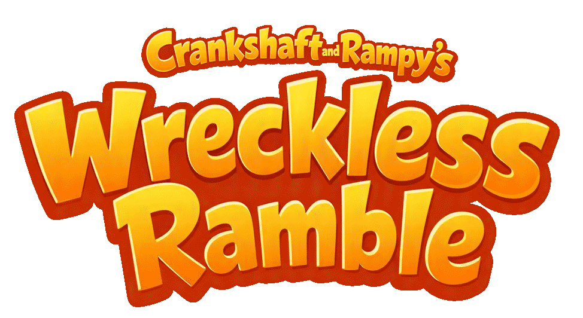

<p align="center">
  
</p>

# Crankshaft and Rampy's Wreckless Ramble

A 3D open-world driving toy (Three.js). Drive around a little city with traffic
lights, ramps, a giant robot, a fire engine, a flame lizard, and a freight
train that circles the town.

> ⚠️ The game uses ES modules (`import` / `export`), which browsers block when
> the page is opened directly from the file system (`file://`). **You must
> serve the folder over HTTP** to play it.

## Start the game from PowerShell

Run these commands in PowerShell to start the game:

```powershell
cd c:\xampp\htdocs\rampy
python -m http.server 8090
```

Then open `http://localhost:8090/` in your browser.

To stop the server, press `Ctrl+C` in the PowerShell window.

## Controls

- **W / ↑** — accelerate
- **S / ↓** — reverse / brake
- **A / ←, D / →** — steer
- **Mouse drag** — orbit the camera
- **Touch** — virtual joystick (bottom-left) on mobile

## Notes

- The world is a torus: driving off any edge wraps you around to the opposite
  side.
- No build step is required — the code runs directly in the browser.
- **The house is the most draw-call-heavy scene** (thousands of small meshes),
  so three costs there are deliberately avoided and are easy to break by
  accident: the sun's shadow map is a cached bake rather than a per-frame pass
  (`houseSun.shadow.autoUpdate = false`, re-armed by `houseShadowTick`), the
  cube-map mirror reflection is only re-baked when the car is at a mirror, and
  `capShadowCasters(houseWorld.group)` strips sub-unit props from the shadow
  pass. Note `__game.perf().calls` only ever reports the colour pass — three.js
  resets `renderer.info` *after* the shadow pass, so shadow draws are invisible
  to it; to see those, compare `renderer.info` with `info.autoReset = false`.

## Developing / testing tips

- **Stale-module gotcha:** `index.html` loads `main.js` with a `?v=<timestamp>`
  cache-buster, but the level modules it imports (`src/levels/**`, `src/modules/**`)
  have none — after editing a submodule the browser will happily serve the old
  copy. Hard-reload the changed modules before judging behavior, e.g. in the
  console: `await fetch('/src/levels/underground/index.js', {cache:'reload'})`
  for each changed file, then reload the page.
- Append `?debug` to the URL for the `window.__game` test hooks (`.car()`,
  `.teleport(x,z,heading)`, surface-aware `.tp2(x,z,heading)`, per-feature
  probes like `.ugStairs()`, `.ugConveyor()`, `.perf()`, `.sceneStats()`).
- Run the whole unit suite with
  `node --test --test-reporter=tap "src/**/*.test.mjs"` — every test is
  headless, no browser needed.
- Tests and probes that import the game's *real* modules (which pull three.js
  off the CDN and touch `document` at import time) need
  `src/objects/nodeShims.mjs`: it installs the DOM globals and redirects the
  CDN three import to the local npm copy. Test files import it themselves; a
  hand-run script takes it as a flag:

  ```powershell
  node --import ./src/objects/nodeShims.mjs src/levels/beach/probe-beach.mjs
  ```
