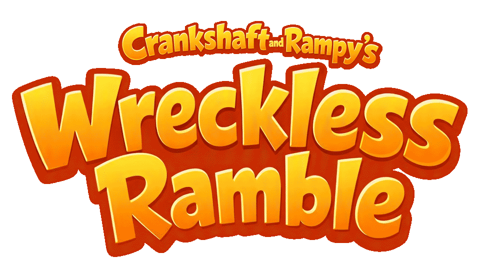

<p align="center">
  
</p>

# Crankshaft and Rampy's Wreckless Ramble

A 3D open-world driving toy built with Three.js. Drive around a little city
with traffic lights, ramps, a giant robot, a fire engine, a flame lizard and a
freight train — then follow the portals to a stunt-ramp world, an underground
mine course, a house, a museum, a beach, a cornfield, a space station and the
county fair (through the flaps of the circus big top).

> ⚠️ The game uses ES modules (`import` / `export`), which browsers block when
> the page is opened directly from the file system (`file://`). **You must
> serve the folder over HTTP** to play it. An internet connection is also
> required — Three.js loads from a CDN.

## Play it

Any static file server works, for example:

```powershell
cd C:\code\rampy
python -m http.server 8090
```

Then open `http://localhost:8090/` in your browser, and press `Ctrl+C` to stop
the server.

## Controls

| Input | Action |
| --- | --- |
| `W` / `↑` | Accelerate |
| `S` / `↓` | Reverse / brake |
| `A` `D` / `←` `→` | Steer |
| `Shift` | Boost |
| `Space` | Pause / unpause |
| `C` | Cycle camera (chase → top-down → cinematic) |
| `H` | Horn |
| `B` | Bookmark the current spot (writes the position into the URL) |
| Mouse drag | Orbit the camera |
| Gear button (top-left) | Car showroom, controls and graphics settings |

Gamepads work out of the box, and touch devices get an on-screen arrow pad.
The showroom's **Multiplayer** tab sets up two-player split-screen (keyboard
halves, two pads, or two touch pads).

## Development

- Run the headless unit suite:

  ```powershell
  node --test --test-reporter=tap "src/**/*.test.mjs"
  ```

- Append `?debug` to the URL to expose test hooks on `window.__game`
  (`car()`, `teleport(x, z, heading)`, `tp2(x, z, heading)`, `perf()`, …).
